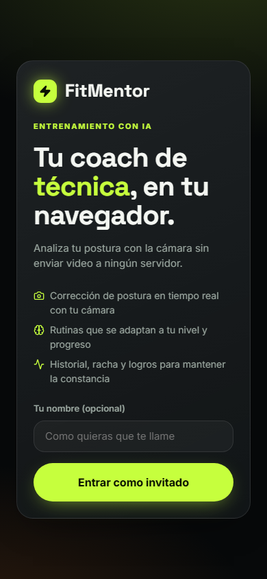

# FitMentor Frontend

Aplicación web de entrenamiento con corrección de postura por IA. La cámara se analiza en el navegador con MediaPipe Pose (versión fijada `0.10.35`); solo viajan al backend los puntos de postura, nunca el video.

El backend es un servicio **Java / Spring Boot** (proyecto `FITMENTOR-BACKEND`) que expone una API REST y un canal en tiempo real **STOMP** sobre WebSocket.




## Qué incluye

| Pantalla | Qué hace |
| --- | --- |
| **Acceso** | Login con Google (Identity Services) o entrada como invitado. |
| **Inicio** | Saludo, racha, meta semanal con anillo, rutina de hoy, sugerencia y logros destacados. |
| **Entrenar** | Cámara con esqueleto neón, cuenta regresiva 3-2-1, conteo de repeticiones, precisión, voz, deshacer, descanso y resumen. |
| **Progreso** | Barras semanales, línea de precisión y reparto por ejercicio. Historial de sesiones del servidor más las pendientes locales. |
| **Rutina IA** | Plan adaptativo con la razón del plan y carrusel de ejercicios. |
| **Logros** | Insignias con progreso entero de 0 a 100 %. |
| **Coach IA** | Chat con sugerencias rápidas. Indica si la respuesta es del coach IA, de la guía de técnica o del modo sin conexión. |
| **Perfil** | Nombre, nivel (Principiante, Intermedio, Avanzado), objetivo, voz, tema y cierre de sesión. |

En móvil la navegación va en una barra inferior; en escritorio, en una barra lateral.

## Requisitos

- Node.js 22 o superior (CI usa Node 22).
- La cámara requiere HTTPS o `localhost`.
- Para datos reales, el backend Spring Boot en ejecución (por defecto `http://localhost:8080`).

## Cómo correr el proyecto

```bash
npm ci
cp .env.example .env.local   # en Windows: copy .env.example .env.local
npm run dev                  # http://localhost:5173
```

Scripts disponibles:

| Comando | Qué hace |
| --- | --- |
| `npm run dev` | Servidor de desarrollo de Vite. |
| `npm run build` | Compila con `tsc -b` y empaqueta con Vite en `dist/`. |
| `npm test` | Ejecuta las pruebas unitarias y de componentes con Vitest. |
| `npm run test:watch` | Pruebas en modo observación. |
| `npm run preview` | Sirve el build de producción en local. |

## Variables de entorno

| Variable | Obligatoria | Descripción |
| --- | --- | --- |
| `VITE_API_URL` | No | URL base del backend. En desarrollo, por defecto `http://localhost:8080`. En producción vacía significa mismo origen. |
| `VITE_GOOGLE_CLIENT_ID` | No | Client ID de Google. Si falta, se oculta el botón de Google y queda solo el acceso como invitado. |

Las variables `VITE_*` se incrustan en el build. No pongas secretos en ellas.

## Contrato REST

Base: `VITE_API_URL`. Las rutas protegidas reciben `Authorization: Bearer <token>`.

| Método y ruta | Uso |
| --- | --- |
| `POST /api/auth/google` | Body `{ credential }`. Devuelve `{ token, user }`. |
| `POST /api/auth/guest` | Body opcional `{ name }`. Devuelve `{ token, user }`. |
| `GET` / `PATCH /api/me` | Perfil. Patch con `name`, `level`, `goal`. |
| `POST` / `GET /api/sessions` | Guarda una sesión y lista el historial (`limit` de 1 a 100). |
| `GET /api/stats` | Estadísticas agregadas. |
| `GET /api/routine` | Rutina adaptativa del día. |
| `GET /api/achievements` | Logros con `progress` entero de 0 a 100. |
| `GET /api/exercises` y `GET /api/exercises/next` | Catálogo y progresiones (`distance`). |
| `POST /api/coach` | Body `{ question, context? }`. Devuelve `{ answer, source }`. |

Convenciones:

- `User` = `{ id, name, email, picture, level, goal, guest, createdAt }`.
- `level` es un enum: `BEGINNER`, `INTERMEDIATE` o `ADVANCED`. La interfaz lo muestra en español; el front siempre envía el enum.
- Los errores del API son JSON `{ error, message }`. El front traduce el código a un mensaje en español (`src/lib/api.ts`, `errorMessageFor`) y no muestra el texto técnico del servidor.

## Contrato en tiempo real (STOMP)

El canal usa STOMP 1.2 sobre WebSocket con `@stomp/stompjs` (versión fijada `7.3.0`).

- **Conexión**: `ws(s)://<api>/ws`. Si no hay API configurada, usa el mismo origen. El CONNECT lleva la cabecera `Authorization: Bearer <token>` cuando hay sesión.
- **Reconexión automática** cada 2 s tras una caída, con latido (heartbeat) de 10 s en ambos sentidos.
- **Sesión de entrenamiento**: cada sesión tiene un `session_id` (UUID v4). Al iniciar se suscribe a sus topics; al terminar, se cancelan.

| Dirección | Destino | Cuerpo |
| --- | --- | --- |
| Publica | `/app/pose` | `{ exercise, points: [{ name, x, y, confidence }], frame_width, frame_height, session_id }`. Doce landmarks, como máximo tres envíos por segundo. |
| Publica | `/app/command` | `{ session_id, name }` con `name` = `pause`, `resume`, `skip`, `finish` o `undo`. |
| Suscribe | `/topic/feedback.{session_id}` | `{ type: "feedback", score, message, feedback: string[], phase, reps, state, exercise }`. |
| Suscribe | `/topic/state.{session_id}` | `{ type: "state", state, exercise }` con `state` = `WARMUP`, `ACTIVE_SET`, `REST`, `PAUSED` o `FINISHED`. |

**Fuente de verdad**: cuando hay conexión y sesión activa, el servidor cuenta las repeticiones y decide la fase y el feedback. El front no cuenta en paralelo (sin doble conteo). Si la conexión cae, el análisis local retoma el conteo desde la última cifra recibida.

**Modo sin conexión**: sin backend, el análisis local de la cámara sigue funcionando. Las sesiones se guardan en `localStorage` y se suben al backend al volver a sincronizar.

## Estructuras de datos

Implementadas en `src/structures/` con uso real y pruebas en `src/structures/structures.test.ts`.

| Estructura | Uso en la app |
| --- | --- |
| `Stack` | Deshacer repeticiones durante una sesión en modo local. |
| `Queue` | Cola de mensajes de voz para que nunca se solapen (`src/lib/speech.ts`). |
| `SinglyLinkedList` | Carrusel de la rutina del día (siguiente y vuelta al inicio). |
| `DoublyLinkedList` + `ListCursor` | Historial de sesiones con anterior y siguiente. |
| `CircularBuffer` | Ventana móvil para suavizar el ángulo y la gráfica de precisión en vivo. |
| `Trie` | Autocompletado del buscador de ejercicios (ignora tildes y mayúsculas). |
| `MinHeap` | Cola de prioridad para sugerir el siguiente ejercicio (`src/lib/suggest.ts`). |
| `LRUCache` | Caché de respuestas del API con TTL (ejercicios y coach). |

## Estructura del código

```
src/
  App.tsx               Contenedor: auth, rutas por hash y páginas
  main.tsx              Punto de entrada; aplica el tema antes del primer render
  components/
    ui/                 Primitivos: Button, Card, ProgressRing, Switch, Segmented...
    layout/             AppShell: barra lateral y barra inferior móvil
    charts/             BarChart, LineChart, Sparkline (SVG propio)
    training/           CameraStage, ExercisePicker, RestTimer, SessionSummary
  pages/                Una página por ruta
  hooks/                useAuth, useRealtime (STOMP), useTrainingSession, usePoseDetector...
  lib/                  API, contrato con el backend, servicios tipados, realtime, pose, voz, sesiones
  structures/           Estructuras de datos y su caché
  styles/               tokens, base, components, layout, pages (un archivo por área)
```

## Diseño y accesibilidad

- Tema oscuro por defecto con acentos lima y naranja. Tipografía Space Grotesk e Inter.
- Tokens CSS en `src/styles/tokens.css`; el tema claro se activa con `data-theme="light"`.
- Foco visible en teclado, etiquetas ARIA en controles, enlace de salto al contenido, regiones en vivo para el feedback.
- `prefers-reduced-motion` desactiva animaciones.
- Diseño responsive: barra lateral en escritorio, barra inferior en móvil, respeto de la zona segura del dispositivo.

## Despliegue en Netlify

1. Conecta el repositorio en Netlify. `netlify.toml` ya define el comando (`npm run build`), la carpeta de publicación (`dist`) y la redirección de SPA.
2. En **Site configuration > Environment variables** define `VITE_API_URL` (URL pública del backend) y, si usas Google, `VITE_GOOGLE_CLIENT_ID`.
3. Añade el dominio de Netlify a los orígenes autorizados del cliente de Google.

`netlify.toml` incluye cabeceras de seguridad y una Content-Security-Policy. Netlify no interpola variables en las cabeceras, así que `connect-src` permite `https:` y `wss:`, lo que deja funcionar cualquier backend configurado en `VITE_API_URL`. Los orígenes fijos que usa la app son `accounts.google.com`, `cdn.jsdelivr.net` (wasm de MediaPipe), `storage.googleapis.com` (modelo de pose) y `fonts.googleapis.com` / `fonts.gstatic.com`.

## Integración continua

`.github/workflows/ci.yml` ejecuta en cada push a `main` y en cada pull request: `npm ci`, `npm run build` y `npm test`.

## Capturas

Las capturas de `docs/screenshots/` se generaron con datos simulados (sin backend real) y un usuario de prueba genérico. Reproducibles con Playwright interceptando las llamadas a la API.

## Pendientes conocidos

- El backend no está en este repositorio.
- Las pruebas cubren estructuras, contrato, pose, realtime (STOMP), sesiones, rutas y el flujo de acceso. El análisis de cámara y MediaPipe se valida manualmente en un navegador con cámara.
